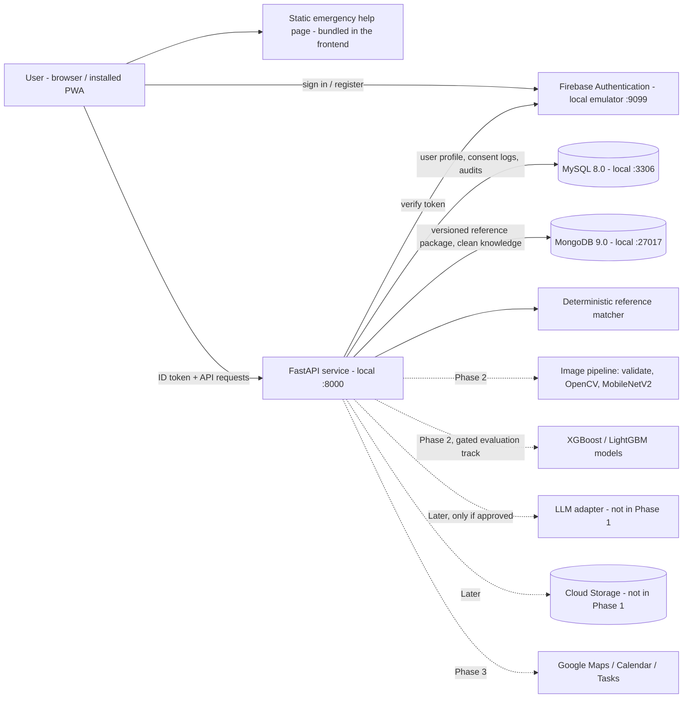

# MEDNOURISH — Architecture

| Field | Value |
|---|---|
| Version | 1.3-draft (owner decisions of 2026-10-11 applied; change summary in `Memory.md` section 12.3, entry S-004) |
| Date | 2026-10-11 |
| Status | Draft for owner review |
| Companion documents | `PRD.md` · `Rules.md` · `Phases.md` · `Design.md` · `Memory.md` |
| This document answers | How the system is structured and which technical decisions are made, proposed or pending |

Status terms (Confirmed, Proposed, Pending, Unverified) are defined in `Memory.md`.

This document contains **no application code**. Tables and diagrams describe design only.

---

## 1. Architectural principles

1. **Knowledge first, models later.** Version 1 runs on a cleaned reference knowledge base and a transparent matcher. Until a qualified reviewer signs off, all of its content is an unreviewed draft (C-17). ML models are added only after verification gates pass (section 8); no ML training happens in Phase 1 (C-12).
2. **Right tool for each data type.** Structured answers → a transparent matcher now, tabular models later if verified. Images → image model (Phase 2). Language → scripted help in Phase 1, LLM only if later approved (C-15). Emergencies → fixed, static wording.
3. **Safety is a layer, not a feature.** In Phase 1 the emergency help page is static, bundled with the frontend and independent of the backend (C-20). Any later automated red-flag rules must run before any chatbot or model output reaches the user.
4. **Privacy by default.** Collect little, isolate by user, delete early, log no personal data.
5. **Configuration over constants.** Anything country-specific (emergency numbers, facilities, legal text) is configuration, never hard-coded (C-05).
6. **Swappable providers.** If an LLM is ever approved, it sits behind an adapter; no feature depends on one vendor.
7. **Originals are read-only.** Files in `datasets/` are never modified (C-09), are never pushed to a remote and are kept out of new Git commits (C-16).
8. **Local first.** Phase 1 runs on the Firebase emulators with fictional data; it creates no cloud project and uses no billing (C-14).

## 2. Technology stack

Stack status: **Confirmed as the prototype stack** (React, Vite, TypeScript, FastAPI, Firebase Authentication and Firestore), **subject to dependency and feasibility checks (PV-14)** (C-07). Items marked "later" are not part of Phase 1.

| Layer | Choice | Status | Verify before use |
|---|---|---|---|
| Frontend | React + Vite + TypeScript, responsive; installable PWA shell that caches static assets only | Confirmed (C-03, C-07) | PV-15 (offline emergency page per platform); OD-15 (styling/UI toolkit) |
| Backend API | Python + FastAPI | Confirmed (C-03, C-07) | PV-14 (versions) |
| Authentication | Firebase Authentication, on the local emulator in Phase 1 | Confirmed (C-07, C-14) | OD-10 (sign-in methods) |
| Relational Database | MySQL 8.0+ (local development / self-hosted) for user profiles, consent logs, and audit logs | Confirmed (OD-16 / Arch Revision 2026-10-12) | Local service availability & credentials |
| Document Database | MongoDB 9.0+ (local development / self-hosted) for versioned reference packages, clean knowledge lookups, and audit artifacts | Confirmed (OD-16 / Arch Revision 2026-10-12) | Local service availability & mongod lock resolution |
| Cloud Database | Cloud Firestore: **replaced in active application path** by MySQL + MongoDB; retained only as optional legacy/emulator fallback | Deprecated in Phase 1 | PV-13 only if cloud sync ever requested |
| File storage | Cloud Storage: **not used in Phase 1** (C-07). Later: opt-in saved images, private model artifacts | Later; Proposed | PV-13 (plan requirements, pricing, region) |
| Tabular ML | XGBoost and LightGBM behind a replaceable scoring interface | Later, in the Phase 2 evaluation track (C-12); no training in Phase 1 | Blocked by PV-01, PV-02, PV-17 and a demonstrated match between collected inputs and verified labels |
| Image ML | MobileNetV2 transfer learning, one model per body region, served from the backend | Later (Phase 2); Proposed (original brief; C-06) | Blocked by PV-04 to PV-06; PV-14 (export format) |
| Image processing | OpenCV (quality gate, resize, normalisation) | Later (Phase 2); Proposed (original brief) | PV-14 |
| Chat / language | Phase 1: scripted, menu-based app help, no LLM, no stored transcripts (C-15, C-23). Later, only with explicit owner approval: a low-cost LLM API behind a provider-swappable adapter | Phase 1 Confirmed; LLM later and Pending | PV-11, OD-06 |
| Hosting | **None in Phase 1** (local only, C-14). Later, if approved: Firebase Hosting for the PWA and a container host for the API | Later; Pending | OD-11, PV-13 |
| Maps / Calendar / Tasks | Google Maps Platform, Google Calendar API, Google Tasks API | Confirmed (brief); Phase 3 | PV-16 |
| Java | Not used in the MVP | Confirmed (C-03) | — |

**Why a separate backend is needed.** In Phase 1 the backend verifies the user's Firebase token, checks ownership, runs the deterministic matcher against the versioned MongoDB reference package and is the only writer of saved records in MySQL, so a user cannot forge a saved result. Later it also keeps keys off users' devices (LLM, Google), runs Python models that cannot run safely in the browser, and enforces image validation and deletion.

**On-device inference (TensorFlow Lite) from the original brief.** Version 1 uses server-side inference (C-06). On-device inference (TensorFlow Lite, now also called LiteRT, or TensorFlow.js) remains a later option with a privacy benefit (images never leave the device). The choice of model export format is deferred (PV-14).

## 3. System context



Solid lines exist in Phase 1; dotted lines are later phases. The emergency help page needs neither the API, nor Firebase, nor a signed-in session.

### 3.1 Architecture boundaries and flow

- **Authentication boundary — browser to Firebase Auth Emulator:** sign-in and token issuance (`127.0.0.1:9099`).
- **Application boundary — browser to FastAPI service:** everything involving profile management, consent recording, matching, reports, and data retrieval. The API verifies the user's Firebase ID token on every request except `/` and `/v1/health`.
- **Data storage boundary:**
  - **MySQL (`app/models/user.py`):** Relational store for `user_profiles` (`id`, `firebase_uid`, `adult_confirmed`, `display_name`, `gender`, `height_cm`, `weight_kg`, timestamps) and `user_consent_logs` (`id`, `user_id`, `consent_version`, `adult_confirmed`, `granted_at`, `ip_hash`). DOB and age are strictly prohibited.
  - **MongoDB:** Document store for `reference_packages`, `clean_knowledge_entries`, and structured audit records.

Clients **cannot write** assessments, summaries, reports, care-plan items or profile data directly to any database; only the authenticated FastAPI service writes them (so a user cannot forge a saved result and all constraints are strictly validated).

## 4. Proposed repository layout

The existing repository already has `docs/` and `datasets/`. Nothing in `datasets/` is changed. The other folders are additions, created only when implementation starts.

```
MedNourish/
├── docs/             # these six documents
├── datasets/         # ORIGINAL data — read-only, never modified, excluded from new commits
├── knowledge/        # (proposed) cleaned copies, schema checks, CHANGELOG
├── backend/          # (proposed) FastAPI service and tests
├── ml/               # (Phase 2) data checks, experiments, evaluation reports, model cards; not created in Phase 1
├── frontend/         # (proposed) React + Vite + TypeScript PWA and tests
└── infra/            # (proposed) Firebase emulator configuration and security rules; no cloud deployment configuration in Phase 1
```

Datasets, secrets, environment files, emulator data, large model files and image data are **not** committed to the repository, and datasets are never pushed to any remote (C-16). Whether any such file is already tracked is Unverified until the Git check (PV-18) is done. The remote's visibility is unconfirmed.

## 5. Data architecture

### 5.1 Relational database schemas (MySQL 8.0)

MySQL stores user accounts, consent history, assessment summaries, reports, and care-plan actions. Foreign keys link records to `user_profiles.id`, which maps 1:1 to `firebase_uid`.

| Table | Contents | Written by | Read by |
|---|---|---|---|
| `user_profiles` | `id` (PK, UUID), `firebase_uid` (indexed unique), `adult_confirmed` (bool, mandatory True), `display_name` (optional), `gender`, `height_cm`, `weight_kg`, `created_at`, `updated_at`. **DOB and age strictly prohibited (C-01, C-21)** | API only | Owner |
| `user_consent_logs` | `id` (PK, UUID), `user_id` (FK), `consent_version` (varchar), `adult_confirmed` (bool), `granted_at` (datetime), `ip_hash` (sha256). Permanent immutable record | API only | Owner |
| `assessments` | `id` (PK, UUID), `user_id` (FK), `session_type` (MedBot / Explorer), `match_summary` (JSON), `reference_package_version`, `matcher_version`, `created_at` | API only | Owner |
| `symptom_checks` | `id` (PK, UUID), `user_id` (FK), `selected_tags` (JSON), `matched_summary` (JSON), `created_at` | API only | Owner |
| `saved_reports` | `id` (PK, UUID), `user_id` (FK), `report_snapshot` (JSON), `package_version`, `matcher_version`, `created_at` (No risk scores or bands) | API only | Owner |
| `care_plan_items` | `id` (PK, UUID), `user_id` (FK), `title`, `description`, `status`, `target_date`, `created_at` (No medication or prescription items) | API only | Owner |

### 5.2 Document database collections (MongoDB 9.0)

MongoDB stores versioned reference packages, clean knowledge catalog lookups, and audit artifacts.

| Collection | Contents | Written by | Read by |
|---|---|---|---|
| `reference_packages` | Versioned knowledge packages (`package_version`, `created_at`, `classes`, `symptoms`, `clean_tags`, `disclaimer_version`). Immutable read-only reference data | ETL / Admin script | API / Matcher |
| `symptom_catalog` | Normalized symptom vocabulary, region associations, synonyms, and safe educational copy | ETL / Admin script | API / Matcher |
| `audit_event_logs` | Security, data minimization, and system health audit events (redacted, no PII/health details) | API only | System auditor |

### 5.2 Cloud Storage (later; not used in Phase 1)

| Use | Rule |
|---|---|
| Saved images (opt-in only, Phase 2) | Private, per-user path, deny-by-default rules, user-deletable |
| Model artifacts | Private bucket; never user-readable |
| Temporary uploads | **Not** stored in Cloud Storage. Images are received by the API, held in memory or short-lived temporary disk, and discarded after processing (C-06) |

### 5.3 Knowledge base (proposed)

The 13 `MedBot_datasets` CSVs are **reference content**, not person-level training records. One file holds one row per class with body region, category, deficiency label and a symptom-keyword list; six region mapping files add narrative symptoms, signs, risk factors and severity labels; six suggested-routine files contain dietary, supplement, lifestyle and follow-up text. After cleaning, the keyword and mapping content can support deterministic, explainable association lookup. These files do not provide independent patient examples or confirmed outcomes for XGBoost/LightGBM training. Their provenance and licence are Unknown (C-16, PV-07, PV-09), and all of their medical content is an **unreviewed draft** (C-17).

Pipeline: originals in `datasets/` (read-only) → cleaned copies in `knowledge/` with a CHANGELOG and schema checks → provenance and licence recorded (even if "Unknown") → versioned, read-only package served by the API (Firestore is not the knowledge-base store in the MVP) → clinical review (PV-17) when a reviewer exists.

**Cleaning tiers (`Rules.md` DAT-04).** Tier 1 mechanical fixes (quoting, whitespace, encoding, header names, added IDs and review-status fields) may be applied and logged. Tier 2 meaning changes (any change to a symptom term, tag, class or nutrient label, splitting or merging tags, synonyms, adult/child or nutritional/non-nutritional classification, excluding a class) need owner approval and, later, reviewer approval.

**Content tiers for the user-facing package.**
- Used for matching and shown, with the educational-prototype banner: symptom tags and the reference entry label, only for adult, nutritional entries.
- Never shown in Phase 1: supplement and drug text, timeframes, severity labels, urgency, treatment or routine recommendations, child-specific rows, and non-nutritional disease classes (C-17, C-18). The cleaned data may keep these fields flagged for review, but the package built for the app excludes them.

Use a composite class key such as `(Body_Region, Category, Class_Label)` because class names like `Normal` recur and class and nutrient naming differs between files; the join between the keyword file and the region files is defined in the matcher specification (M1B.1). Saved results store the package and matcher versions (REPORT-04).

The separate main CSV (4,000 rows) has Unknown provenance, label-generation method, licence and clinical validity, and contains lab-value and nutrient-intake columns that the symptom questionnaire does not collect. It is not a drop-in training source for the deficiency-mapping task until those issues and the input/target mismatch are resolved (PV-01). The audit record, with what was verified and what is only a historical, unrepeated finding, is in `Memory.md` section 7; counts and findings are kept only there.

## 6. API surface (design only)

All routes are versioned under `/v1`, require a verified Firebase ID token unless stated, and validate every input. The only public route is the health check. Emergency guidance is **not** an API route: it is a static page in the frontend (C-20).

| Area | Routes (names only) | Phase |
|---|---|---|
| Health | health check (public) | 1A |
| Profile and consent | profile read/update · record consent · delete account | 1A |
| MedBot | create session · submit answers · get result | 1B |
| Symptom Reference Explorer | list tags · match selection | 1B |
| Reports | list · get (export deferred) | 1B |
| CarePlan | list · create · update · complete | 1B |
| App help (NurseBot, scripted) | get menu · get scripted answer (no free text, no stored transcripts) | 1B |
| MedScan | create scan session · upload image · get result | 2 |
| VirtualWard | triage · nearby facilities | 3 |
| Integrations | Google connect/disconnect · calendar and task sync | 3 |
| Doctor chat | real-time messaging design | 4 (Pending) |

## 7. Safety architecture

**Phase 1 layers (Confirmed, C-20):**

1. **Static emergency help (not AI, not the backend):** a page bundled with the frontend, reachable from every screen including signed-out and offline states, with generic wording and region text only from configuration. It never says "no red flags found". There is **no automated emergency-triage or red-flag engine** in Phase 1.
2. **Input handling:** validation, length limits and allowed values on the server. Phase 1 has no free-text health input that the app analyses.
3. **Core logic:** the deterministic reference matcher over the versioned package.
4. **Content and wording safeguards:** the user-facing package is built without excluded fields (supplement, drug, timeframe, severity, urgency, treatment, child-specific, non-nutritional); automated tests and a text scan enforce required wording and disclaimers and block forbidden terms.
5. **Presentation:** ordered reference match summary with matched tags, the educational-prototype disclaimer, and a general prompt to speak with a qualified clinician. No bands, urgency tier or severity.

**Later layers (only when approved and reviewed):** automated red-flag and crisis rules that run before any chatbot or model output, with a clinically reviewed rule list (PV-17) and required before any free-text health input is analysed; an output filter for LLM text. Candidate red flags drawn from the CSV content (for example, eye pain with sudden vision loss; the combination of rash, diarrhoea and confusion) are inputs to clinical review, not approved rules.

Specific wording rules are in `Rules.md`; presentation patterns are in `Design.md`.

## 8. AI/ML architecture

### 8.1 Model roles

| Component | Handles | Does not handle | Status |
|---|---|---|---|
| Deterministic reference matcher | Selected symptom tags → an ordered reference match summary (matched tags and counts) over the versioned package | Diagnosis, risk levels, probabilities, severity, unsupported conditions, unknown associations | Phase 1B foundation; specification to be written and approved in M1B.1 (C-18); content gated by PV-07 and PV-17 |
| XGBoost / LightGBM | Structured inputs only, through a model adapter if later approved | Raw images; conversation; features not collected from users | **Not trained; no training in Phase 1 (C-12).** Phase 2 evaluation track only, after PV-01, PV-02, PV-17, feature/label compatibility and owner approval |
| MobileNetV2 (per region) | Images only | Questionnaire data; conversation | **Not trained**; blocked by PV-04 to PV-06; PV-14 (export format) |
| LLM | Language: explaining, rephrasing, answering from retrieved knowledge | Diagnosis, doses, emergencies, scoring | **Not in Phase 1 (C-15).** Provider Pending |
| OpenCV | Quality gate and preprocessing | Diagnosis | Later (Phase 2); Proposed |

The 13 mapping CSVs contain condition-to-keyword associations, not independent examples from people with verified outcomes. Use them only as an unreviewed reference knowledge base for transparent matching. Do not turn rows or synthetic variants of rows into evidence that a model can identify a person's deficiency. The separate main CSV may be investigated in the Phase 2 evaluation track (the project should ultimately evaluate ML models, C-12), but its labels, provenance, licence and overlap with what the app asks users must first be verified. In Phase 1, MedBot and the Symptom Reference Explorer share the same versioned package and deterministic matcher while keeping distinct input flows: guided answers versus direct symptom selection.

### 8.2 Verification gates (G1–G6)

A model may reach users only after **all** gates are passed and recorded in its model card. Numeric thresholds are **not defined here**; they must be set with the clinical reviewer *before* testing (OD-03, PV-17).

| Gate | Requirement |
|---|---|
| G1 Data verified | Provenance, licence, label method, class counts, duplicates and near-duplicates, leakage and bias checks done and recorded |
| G2 Task approved | A clinical reviewer approves what the model may and may not say |
| G3 Baselines | Simple baselines (majority class, rule engine) measured; the model must beat them |
| G4 Honest evaluation | Duplicates removed before splitting; held-out test data never used for tuning; per-class results, confusion matrix, and subgroup results (age, gender, skin tone and lighting for images) |
| G5 Calibration and abstention | Scores calibrated; any user-facing presentation of model output (bands, percentages or otherwise) needs separate owner and reviewer approval; "Normal", "Other" and "unclear — retake" outcomes supported |
| G6 Release decision | Model card written; shadow mode first (results logged, not shown); user-facing label "experimental" |

Non-nutritional classes (for example diabetes, cancer, alopecia, other ocular conditions) are kept as **separate** classes, never relabelled as vitamin deficiencies, and **not displayed to users in the MVP** (C-18).

### 8.3 Data and training pipeline (all steps need owner approval before running)

1. Verify provenance, licensing, labels, intended population, and input/target fit (G1) → 2. Have a clinical reviewer approve the task and limits (G2) → 3. Clean copies only → 4. Define user-available features and targets without label leakage → 5. Split independent records with duplicate-safe, stratified or grouped splits → 6. Measure a simple baseline → 7. Train and compare XGBoost/LightGBM only if the verified data supports the exact task → 8. Evaluate by class and relevant subgroups, calibrate or abstain → 9. Model card and evaluation report → 10. Owner release decision. Synthetic examples generated from the mapping tables may test software plumbing only; they must not be presented as evidence of clinical prediction or drive user-facing deficiency scores.

### 8.4 What the existing data can support (preliminary; details in `Memory.md` section 7)

All audit findings are **preliminary and not independently re-verified**; counts and detailed findings are kept only in `Memory.md` section 7.

- The 13 reference CSVs can support symptom-tag vocabulary and deterministic table matching after cleaning, provenance checks and, when possible, clinical review. They cannot establish model performance.
- The main CSV's provenance and labels are unverified, and its outcome labels do not directly match the class labels in the symptom mapping table. The notebook is exploratory, not model training. No model has been trained or evaluated.
- The image folders use visibly different label taxonomies and annotation formats across body regions. A file inventory is not label validation. Duplicates, provenance, annotation semantics and licences remain open (PV-04 to PV-06, PV-09).
- Until evidence supports a task, Phase 1 uses the transparent unreviewed lookup; for MedScan use guided capture without AI or withhold a region (SCAN-07).

## 9. Chat architecture

**Phase 1 (Confirmed, C-15, C-23):** NurseBot is scripted, menu-based application help only. There is no LLM, no free-text input, no stored transcript, and no nutrition or medical question answering. Out-of-scope requests lead to a scripted refusal.

**Later design, only if the owner explicitly approves it (including any payment):** MedBot Detailed mode and NurseBot Q&A. Flow: user message → input handling → automated red-flag and crisis rules (reviewed rule list required first) → retrieval from a **reviewed** knowledge base (none exists yet; the current CSVs are unreviewed) → LLM adapter with a fixed safety prompt → output filter → response with sources and disclaimer. On any failure → scripted fallback.

- **Provider-swappable adapter:** the choice is Pending (PV-11, OD-06). Before any selection, collect provider facts (prices, retention, training use, limits, free-tier terms) from official sources with the URL and retrieval date, and run a written safety test set. No provider facts are currently recorded in `Memory.md`.
- **No paid API or subscription without the owner's explicit approval.** Development uses fictional data only.
- **Data minimisation:** requests contain no names, IDs or photos (PRIV-02); free-text symptoms are still health data, so the consent text and the list of data processors must cover them before any use.
- **Cost controls:** max tokens, per-user rate limits, and a spending limit whose nature (hard cap or alert only) has been verified.

## 10. Image pipeline (Phase 2; design only)

1. Authenticated upload to the API (not directly to storage).
2. **Validate:** file type by content (not extension); allow-list (JPEG, PNG, WebP); maximum file size and pixel dimensions; reject everything else.
3. **Sanitise:** decode and re-encode; strip metadata including location data; use random server-side names.
4. **Quality gate (OpenCV):** blur, brightness, size → ask the user to retake if poor.
5. **Analyse:** per-region model (only if gates G1–G6 passed); otherwise the fallback in SCAN-07.
6. **Respond:** pattern group, with any confidence presentation approved under gate G5, an "experimental" label and disclaimers.
7. **Delete:** discard originals and derivatives immediately after processing, unless the user explicitly saved the image.
8. Photos are **never** sent to an external LLM.

## 11. Security and privacy architecture

| Topic | Design (Proposed unless marked) |
|---|---|
| Authentication | Firebase Authentication (emulator in Phase 1); API verifies the ID token on every request except the health check |
| Authorisation | Ownership check on every read; **all writes only through the API**; Firestore rules deny by default with explicit, restrictive allow rules (owner reads only) and no wildcard allow; rules tested with the Firebase emulator (Confirmed, C-14) |
| Abuse protection | Rate limits; Firebase App Check evaluated only if cloud use is approved (PV-13) |
| Secrets | Environment variables or a secret manager; never in the repository or frontend; excluded from new commits (C-16) |
| Transport and storage | Local only in Phase 1. If cloud use is later approved: HTTPS only; encryption at rest by the managed services |
| Logging | No health details, symptoms, answers, names, tokens or image content; request ID, time, outcome category, version identifiers only (Confirmed, C-23) |
| Consent | Versioned records; explicit, not pre-ticked 18+ confirmation (self-declared; its limits are acknowledged) |
| Rights | Delete account and data (Phase 1). Own-data export is required before any real user data (real-data readiness gate) |
| LLM | None in Phase 1. If later approved: minimised payloads; consent text covering the processing; vendor terms re-verified (PV-11) |
| Compliance | Privacy-law and medical-software classification depend on the target country (PV-10, PV-12). No regime is assumed. Flag for review before any real user data or public release |
| Development data | Fictional only (A2, C-23) |

### 11.1 Retention (principles Confirmed; durations Pending OD-08)

| Data | Rule | Status |
|---|---|---|
| Uploaded images (in flight) | Held only during processing; deleted automatically afterwards | Confirmed (C-06) |
| Processed derivatives (resized/cleaned copies) | Same lifetime as the upload; never persisted | Confirmed (C-06) |
| Temporary files | Short-lived; a sweep job removes stragglers; sweep interval Pending | Confirmed principle; duration Pending |
| Caches | The service worker caches static assets only (including the emergency page). No API responses, user data, reports, photos or derivatives are cached on the device in Phase 1 | Proposed (tested in M1A.3) |
| Saved images (explicit opt-in) | Private, per-user, deletable at any time; optional expiry Pending | Confirmed principle; details Pending |
| Logs | No health details, symptoms, answers, names, tokens or image content; retention period Pending | Principle Confirmed (C-23); period Pending (OD-08) |
| Backups | Temporary data excluded; deletion propagates as provider backup cycles allow; to be verified | Pending (PV-13, only before cloud use) |
| Assessments, reports, CarePlan | Fictional data only in Phase 1; kept until the user deletes them or the account. Deleting the account deletes all of them | Proposed |
| NurseBot transcripts | Not stored in Phase 1 (scripted help, no free text) | Confirmed (C-23) |
| Consent records | Development deletes them with the account. Whether a minimal record is kept after deletion, and for how long, must be documented before any real user data | Pending (OD-08) |

Deletion and retention requirements must be documented before any real user data is introduced (C-23; real-data readiness gate in `Rules.md` section 9).

## 12. Integrations

| Integration | What it needs | Main limits and open points | Phase |
|---|---|---|---|
| Google Maps (nearby facilities, directions) | API key, billing account, user location permission | Facility data may be incomplete; cost; sends location to Google; PV-16 | 3 |
| Google Calendar | OAuth consent; sensitive scope may need Google's app verification for public release | PV-16 | 3 |
| Google Tasks | OAuth consent | Believed to store a due date, not a time of day, so it cannot ring a timed alert (verify, PV-16) | 3 |
| Reminders | In-app, general wellness tasks only, firing while the app is open (1B); web push later. No medication reminders (C-22) | In-app reminders may not alert when the app is closed; PWA push support differs by platform (PV-15) | 1B / 3 |
| Doctor–patient chat | Verified clinicians; real-time messaging; consent, retention, legal review | Technically feasible with Firestore real-time; legal and clinical duties dominate (PV-12) | 4 |
| Hospital booking | A partner hospital or request form | No universal booking interface | 3 (request) / 4 |
| Video or call consultation | Provider choice and cost | Pending | 4 |

## 13. Deployment and operations

**Phase 1 (Confirmed, C-14):** local development only, on the Firebase emulators, with fictional data. No cloud project, no billing, no public deployment, no hosting, no multiple environments. Automated checks (lint, type-check, tests) run locally.

**Later, only with the owner's explicit approval (Proposed):**
- Separate development, staging and production environments, each with its own Firebase project and spending limits whose type (hard cap or alert) has been verified (PV-13).
- Deployment automation, added after the MVP works locally.
- Model artifacts versioned and stored outside the repository; each release records model, package and matcher versions.
- Monitoring: error tracking, health checks, cost alerts. Phase 2 adds model monitoring for shadow-mode comparison.
- Backup and restore plan for Firestore: Pending (OD-08, PV-13).

## 14. Testing architecture (details in `Rules.md`)

Phase 1: unit, API contract, security-rules (emulator), end-to-end, accessibility (automated plus keyboard and screen-reader spot checks), forbidden-wording scan, offline emergency-page test. Later: LLM safety set (only if an LLM is approved), image-upload attack set (Phase 2), ML evaluation reproducibility checks. Test data is fictional. No testing with human participants until PV-19 is resolved (C-24).

## 15. Items AI tools must verify before implementing affected features

The authoritative table is in `Rules.md` (section 9). Summary: first commit needs PV-18 and PV-14 · ML training (Phase 2 only) needs PV-01 to PV-07 · reference-package content needs PV-07 (may be recorded as Unknown), the OD-04 plan and OD-19 · region-specific content needs PV-10 · the offline emergency page needs PV-15 · any LLM (not in Phase 1) needs PV-11 · any cloud use needs PV-13 and the owner's approval · ML libraries need PV-14 · Google integrations need PV-16 · testing with people needs PV-19.
