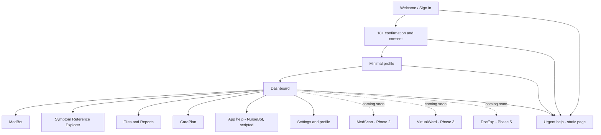

# MEDNOURISH — Design (UI/UX and Accessibility)

| Field | Value |
|---|---|
| Version | 1.3-draft (owner decisions of 2026-10-11 applied; change summary in `Memory.md` section 12.3, entry S-004) |
| Date | 2026-10-11 |
| Status | Draft for owner review |
| Companion documents | `PRD.md` · `Architecture.md` · `Rules.md` · `Phases.md` · `Memory.md` |
| This document answers | How the app should look, read, sound and behave for very different users |

Status terms (Confirmed, Proposed, Pending, Unverified) are defined in `Memory.md`.

There is **no existing UI or Figma design to preserve** (C-02). Everything below is a Proposed starting point for the owner to react to, except where a C-xx decision is cited. No application code is included.

---

## 1. Design principles

1. **Calm and clear.** Few things per screen; one main action per screen.
2. **Sorted, never jumbled.** The same layout, labels and positions everywhere (owner's brief: "sorted not jumbled").
3. **Plain language, plus pictures and sound.** Every important message has text, an icon and an optional spoken version.
4. **Honest, never alarming and never falsely reassuring.** Results say what is known and unknown (SAF-05, SAF-06). Wording avoids risk, prediction and probability claims (SAF-17).
5. **Safety is always one tap away**, even signed out and offline (DASH-02, C-20).
6. **Works for the least confident user, rewards the most knowledgeable.** Two MedBot modes in Phase 1 (Simple, Standard); a Detailed mode is deferred (PRD section 3).
7. **Mobile first, then larger screens.**

## 2. Users and modes

| User | Design response |
|---|---|
| Prefers minimal reading or typing | **Simple mode**: one yes/no question per screen, two large buttons with icons, Listen button, progress dots |
| Literate user | **Standard mode**: multiple choice, short groups of questions, clear results |
| Little health interest, short on time | Short check-ins, visible benefit ("what this gives you"), gentle reminders, quick results |
| Medical knowledge | Phase 1: matched tags and the package version are visible on results. **Detailed mode** (free text, LLM-assisted) and report export are deferred (C-15, `Phases.md` section 9) |

The mode (Simple or Standard) is chosen at the start of MedBot and can be changed at any time. The preference is saved in settings.

## 3. Information architecture and navigation

Urgent help is a static page bundled with the frontend. It is reachable from every screen, including Welcome, sign-in and consent, and works signed out and offline.

**Navigation pattern (Proposed):**
- **Phones:** bottom bar with five items — Home, Check (opens a chooser: MedBot, Symptom Reference Explorer; MedScan later), Reports, CarePlan, More (App help, Settings, About). An always-visible "Urgent help" button in the header, on every screen including signed-out ones.
- **Wider screens:** the same items in a side rail.
- Every screen has a clear title, a back action, and the Urgent help button.
- Home shows all module tiles (DASH-01). Unavailable modules are visibly "Coming soon", never hidden.

## 4. Screen inventory

Every screen traces to a requirement in `PRD.md`.

### Phase 1 (MVP)

| ID | Screen | Requirements | Notes |
|---|---|---|---|
| S-01 | Welcome / Sign in / Sign up | AUTH-01, AUTH-02 | Short value statement; link to "How it works"; Urgent help button visible |
| S-02 | 18+ confirmation and consent | AUTH-03, PRIV-01 | Plain-language summary first, details expandable; the 18+ confirmation and consent are deliberate actions, never pre-ticked; declining leaves Urgent help available |
| S-03 | Profile setup | PROF-01 | Optional display name; optional gender, height and weight (units chosen by the user), clearly marked optional; no date of birth or age field (C-21) |
| S-04 | Dashboard | DASH-01, DASH-02 | Module tiles with icon, label, one-line description |
| S-05 | Urgent help | SAFE-02, SAFE-05, DASH-02 | Static page; see section 7 |
| S-06 | MedBot start (mode picker) | MEDBOT-02 | Two modes (Simple, Standard) explained in one line each; Detailed mode is deferred |
| S-07 | MedBot question (Simple and Standard) | MEDBOT-01, 05, 06, 08 | Symptom questions drawn from the approved tag subset; optional lifestyle questions only if approved (OD-18) and shown as optional; skip/back/progress; explain why each sensitive question is asked; no free-text input |
| S-08 | MedBot chat (Detailed) | MEDBOT-02 | **Deferred beyond Phase 1** (C-15); no screen is built |
| S-09 | Result (shared pattern) | MEDBOT-04, SAFE-01, SAFE-03 | Reference match summary (section 6); distinguish a table match from any future experimental model output; never say a disease or deficiency is confirmed |
| S-10 | Symptom Reference Explorer: choose symptoms | SYMP-01, SYMP-02 | Search box + grouped chips by body region; selected chips shown above the results button |
| S-11 | Symptom Reference Explorer: results | SYMP-03 | Ordered reference match summary with matched tags; no bands, percentages or probabilities; no non-nutritional classes; educational-prototype disclaimer |
| S-12 | Match detail | SYMP-04 | Show the matched tags and the package version; no severity, urgency, advice or treatment text until reviewed |
| S-13 | Files and Reports home | REPORT-01 | Saved reference match summaries; never called a risk score or risk indicator (C-18) |
| S-14 | Check-in history | REPORT-02 | Timeline of saved checks with dates and matched tags; plain-text alternative for any chart; never "improved" or "worsened" wording |
| S-15 | Report view (in app) | REPORT-03 | Includes disclaimers and the versions used. **No PDF export in Phase 1** (deferred) |
| S-16 | CarePlan: today | CARE-01, CARE-03 | Checklist with large tick targets |
| S-17 | CarePlan: add or edit task, reminder | CARE-02, CARE-04 | User-created water, food, exercise tasks; in-app reminders with the note that they may not alert when the app is closed. **No medication reminders** (C-22); no medicine suggestions |
| S-18 | App help (NurseBot) | NURSE-01, 03, 04 | Menu-based scripted help, no free-text box, no stored transcripts; clear "I can't help with that safely" pattern |
| S-19 | Settings and privacy | AUTH-05, PRIV-01, I18N-01, A11Y-03 | Language (English only), text size, read-aloud, mode, delete account, consent history. Own-data export is not in Phase 1 |
| S-20 | How it works and disclaimer | SAFE-01 | Plain language |
| S-21 | Coming soon | DASH-01 | One short explanation per module |

### Later phases (placeholders; designs to be detailed when the phase starts)

| ID | Screen | Phase | Requirements |
|---|---|---|---|
| S-30 to S-35 | MedScan: intro and guidance, capture/upload, quality feedback, processing, result, saved-image management | 2 | SCAN-01 to SCAN-06 |
| S-40 to S-43 | VirtualWard home, nearby facilities, appointment request, connect Calendar/Tasks | 3 | WARD-01 to WARD-05 |
| S-50 to S-53 | Doctor list, chat, consultation, reviews | 4 | CHAT-01 to CHAT-03 |
| S-60 | DocExp | 5 | DOCEXP-01 |

## 5. Core components (Proposed)

| Component | Behaviour |
|---|---|
| Large choice button | Icon + text label; minimum comfortable touch size (section 10); clear selected and focus states |
| Listen button | Reads the question or result aloud (section 9) |
| Progress indicator | Text ("Question 3 of 8") plus visual; announced to screen readers |
| Symptom chip | Text label + icon; toggle state indicated by shape and text, not colour alone |
| Result card | See section 6 |
| Disclaimer strip | Short, always visible on result screens; full text one tap away |
| Urgent help button | Fixed position, high contrast, consistent label; present on every screen, including signed-out screens (C-20) |
| Demo-status banner | Shown in every build while PV-17 is open: "Educational prototype — content has not been clinically reviewed" (final wording: OD-20) |
| Error and empty states | Say what happened and what to do next in plain words; never blame the user |
| Consent switch | Off by default; label states exactly what is shared |

The styling approach and component library are Pending (OD-15). Whatever is chosen must support the tokens and accessibility requirements here.

## 6. Result presentation pattern

One pattern is used for MedBot, the Symptom Reference Explorer and (later) MedScan results. In the Phase 1 demo it represents a **match to reference-table content**, shown as an ordered **reference match summary**. It is not a diagnosis, probability, risk score or risk level, and it uses no Low/Moderate/High bands (C-18). Content stays marked as an unreviewed draft until PV-17 is closed.

**Anatomy, top to bottom:**
1. **Title:** "Reference match summary" and what the user checked.
2. **Educational-prototype disclaimer** (SAF-07, SAF-17): the table has not been clinically reviewed, the list is not a diagnosis, and a match cannot rule a condition in or out. Draft wording: section 13.
3. **Ordered list of reference entries.** Each entry shows its label (subject to OD-19), the **matched tags** in plain language, and the **number of tags matched**. The order is deterministic and follows the matcher specification (`Phases.md` M1B.1); ties follow the specified tie rule. No colour coding that implies severity or reassurance; entries look the same except for their position.
4. **Non-nutritional classes are not shown** (C-18).
5. **When to speak with someone:** the general prompt to speak with a qualified clinician about any health concern. No urgency tier, severity or timeframe until reviewed (SAF-08); never derive urgency from an unreviewed match.
6. **Actions:** Save summary · Listen. Optional wellness tasks the user creates themselves live in CarePlan; no suggestions are generated from the match (C-17).
7. **Demo-status banner** (SAF-07).
8. Any future ML-derived result carries an **"Experimental"** label plus a plain-language limitation note; this label alone does not make unsupported scores suitable for users (SAF-12).

When too few tags are selected for the minimum-information rule, the screen shows **Insufficient information** in place of the list.

**Presentation rules:**
- Do not show a risk score, band, percentage, probability or "risk" wording (C-18, SAF-17).
- Do not use any wording that says "you are fine", "no red flags found" or "nothing detected". Explain that a table match cannot rule a condition in or out (SAF-06).
- "Insufficient information" must invite the user to continue or speak with a clinician; it never reassures (SAF-06).
- Do not use green, amber or red status colours on result entries.

## 7. Emergency and urgent-help pattern

- A persistent **Urgent help** entry is reachable from every screen, including Welcome, sign-in and consent, when signed out and when offline (DASH-02, C-20).
- It opens a **static page bundled with the frontend**. It does not need the backend, an account, the network after the first visit, or any LLM or AI result (SAF-03; `Phases.md` M1A.3).
- The page says, in plain words: "If you think this is an emergency, contact your local emergency services now."
- Emergency numbers and support lines come **only** from region configuration (SAF-04). If a region is not configured, the page shows the generic sentence and no number. Numbers are never typed into screens or components (GR-05).
- The page also carries supportive wording for a person thinking of harming themselves: no judgement, a pointer to local emergency and support services, and a way back to the app (SAF-11).
- The page does not diagnose, does not ask questions that delay action, and **never** says "no red flags found" or any all-clear (SAF-06).
- Phase 1 has **no automated red-flag or triage engine** that stops a flow and opens this page (C-20, SAF-15). The page is available at all times, but nothing in the app decides for the user that an emergency exists.
- The final wording is an **unreviewed draft** until clinical review (PV-17).

## 8. Visual design tokens (Proposed starting values)

The contrast figures below were **reported** in an earlier session (Memory S-002) as computed with the WCAG relative-luminance formula. They were **not re-measured** when this draft was corrected. Re-measure every pair at M1A.2, record the method, and re-check whenever a value changes. Status colours for result entries are not used (section 6).

| Token | Value | Use | Measured contrast |
|---|---|---|---|
| bg | #F7FAF9 | Page background | — |
| surface | #FFFFFF | Cards, inputs | — |
| text-primary | #1B2B2A | Body text | 14.03:1 on bg · 14.73:1 on surface |
| text-secondary | #41524E | Secondary text | 7.87:1 on bg |
| primary | #0B6E69 | Buttons, links, active items | 5.80:1 on bg (links) · white on primary 6.09:1 |
| border-strong | #6B7F7A | Input and control borders only | 4.25:1 on surface (meets the 3:1 target for UI components; **not for text**) |
| focus-ring | #1D4ED8 | Keyboard focus outline | 6.38:1 on bg |
| emergency | white on #B3261E | Urgent help button | 6.54:1 |

The four band colour pairs of the earlier draft were removed with the bands (C-18).

**Colour is never the only signal.** Chips, toggles and the Urgent help button have shape, icon and text states (WCAG use-of-colour).

**Dark mode** is not included in Version 1. If added later, every pair must be re-measured.

**Typography (Proposed):** system font stack (no external font downloads, which also avoids sending users' requests to a font host); body text at least 16 px; line height around 1.5; layouts must still work when users enlarge text to 200%. Headings follow a clear, consistent scale.

**Spacing and shape:** generous spacing, rounded corners, clear card edges. Exact values are decided when the scaffold is built (OD-15).

**Icons:** one consistent icon set (choice Pending, OD-15). Icons always accompany text, never replace it. Illustrations are optional and avoid anything frightening.

**Motion:** minimal; respects the user's "reduce motion" setting; no auto-playing animation.

## 9. Voice read-aloud and low-literacy support

- A **Listen** button appears on questions, results and key instructions (A11Y-03, "where practical", C-05).
- Proposed first approach: the browser's built-in speech output where available. Availability, voice quality and language coverage vary by device, browser and language, so each target must be tested (PV-15). Pre-recorded audio is a later alternative if built-in speech is not good enough.
- Spoken text is the same as, or a simplified version of, the on-screen text and is stored in the translation files (I18N-01).
- Question wording: short sentences, everyday words, one idea per question, examples where helpful. A reading-level target will be set after testing with real users; none is assumed here.
- Pictures or icons support every Simple-mode question; text always remains present.
- Medical terms are explained in place ("B12 — a vitamin found in animal foods and fortified foods") and are never the only wording.

## 10. Accessibility requirements

Target: **WCAG 2.2 level AA** (Proposed, A11Y-01).

| Area | Requirement |
|---|---|
| Keyboard | Everything works without a mouse; visible focus; logical order; no keyboard traps |
| Screen readers | Semantic structure, labelled controls, announced progress, announced errors and status changes |
| Touch targets | Not smaller than the WCAG 2.2 minimum of 24 by 24 CSS pixels; a larger comfortable size (about 44 px or more) is the Proposed default for primary actions |
| Contrast | Text at least 4.5:1; UI components at least 3:1 (see tokens) |
| Text resizing | Usable at 200% zoom and with larger system text; no loss of content |
| Colour | Never the only carrier of meaning |
| Forms | Visible labels, clear error messages that say how to fix, no timing traps, sensible autofill |
| Motion and media | Respect reduced-motion; captions or transcripts for any audio or video |
| Charts | Text summary or table alternative for every chart (Progress tracker) |
| Language | Page language declared; text-expansion allowance. Right-to-left readiness is deferred (I18N-02) |
| Testing | Automated checker plus keyboard and screen-reader spot checks in every milestone (`Rules.md` section 6) and a final audit in M1B.7. Usability sessions with participants are not arranged until the institution's requirements are checked (C-24, PV-19; section 15) |

## 11. Responsive layout and PWA behaviour

- **Mobile first.** Single column on phones; two columns on tablets where it helps; side rail and wider content on desktops. Breakpoint values are chosen when the scaffold is built.
- **Installable PWA** (PWA-01): app icon, name and standalone display. Install prompts and push behaviour differ by platform (PV-15); the app must work fully in a normal browser tab.
- **Offline (Confirmed for the emergency page, C-20; test per platform, PV-15):** the Urgent help page and the minimal app shell are available offline, from a cache of **static assets only**. Reports and any other health data are **not** cached on the device, because a shared device could expose them; anything that needs the server shows a clear "You are offline" state. Caching saved reports offline is deferred (`Phases.md` section 9). No photos are cached (`Architecture.md` 11.1).
- **Performance:** targets Pending (PERF-01); keep pages light for slow connections.

## 12. Internationalisation

- English first (C-05). All text, spoken text, labels and error messages are in translation files (I18N-01).
- Allow for longer text (many languages are longer than English). Right-to-left readiness is deferred until a second language is chosen (I18N-02, OD-13).
- Dates, numbers, units and name fields follow the user's locale; do not assume a first-name/last-name structure.
- Additional languages are Pending (OD-13). Any new language's medical text needs the same clinical review as English.

## 13. Tone and microcopy guidelines

- Friendly, respectful, simple. No fear, no blame, no jokes about health.
- Say "matches", "listed with", "worth discussing with a clinician". Never "you have", "you are fine", "no red flags found", "risk" or "prediction" (SAF-05, SAF-06, SAF-17).
- Always give a next step.

| Situation | Example (Proposed; final wording needs review, OD-20) |
|---|---|
| Educational-prototype disclaimer (Symptom Reference Explorer and result screens) | "Educational prototype. This tool compares the symptoms you pick with a reference table that has not been clinically reviewed. It is not a diagnosis and cannot tell you whether you have or lack any vitamin. For any health concern, speak with a qualified clinician." |
| Disclaimer strip | "General information, not a diagnosis. A clinician can advise you." |
| Insufficient information | "We need a few more answers to say anything useful. Would you like to continue?" |
| Out-of-scope help question | "I can't answer that safely. A doctor or pharmacist is the right person to ask." |
| Medicine or dose question | "I can't advise on medicines or doses. Please ask a doctor or pharmacist." |
| Offline | "You are offline. Urgent help is still available. Other screens need a connection." |
| Reminder note | "Reminders only work while this app is open." |
| Later, only if an LLM is approved: LLM unavailable | "The chat helper is resting. Here are common questions you can use instead." |

## 14. Chat interface (Phase 4 preview)

- A familiar messaging layout: message bubbles, timestamps, delivery states, a clear separation between the patient's and the doctor's messages.
- Inspired by common messaging patterns only. It must not copy any existing app's logos, icons, colours or exact design.
- Attachments are restricted (types and size). Conversation consent, retention, export and deletion are designed with legal review (PV-12).
- A permanent notice states that emergencies go to emergency services, not to chat.
- Detailed design happens when Phase 4 starts.

## 15. Usability testing plan (Proposed; **not to be arranged yet**)

**No testing with human participants is arranged until the institution's ethics and supervisor requirements have been checked (C-24, PV-19).** Phase 1 uses the owner's review, automated accessibility checks and keyboard and screen-reader spot checks instead. If testing is later approved, the plan below applies:

- Test with fictional scenarios only (GR-08).
- Include people who are not confident with technology or reading, people who use screen readers or magnification, and people with some medical knowledge.
- Questions to answer: Can they find and finish a MedBot check? Do they understand the reference match summary and the disclaimer? Do they notice and understand the Urgent help button? Do they ever read a result as a diagnosis or as a reason not to see a clinician?
- Record findings in `Memory.md` and update this document where needed.

## 16. Design items still open

OD-13 additional languages · OD-15 styling approach, component library and icon set · OD-19 display of reference entry names before review · OD-20 label scope and disclaimer wording · PV-15 platform behaviour for the offline emergency page, read-aloud, install and push · PV-17 final wording of results and emergency content · PV-19 testing with people · PERF-01 performance targets.
