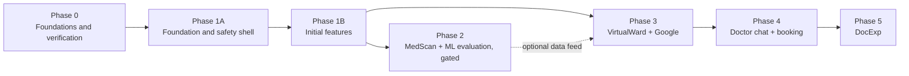

# MEDNOURISH — Development Phases

| Field | Value |
|---|---|
| Version | 1.3-draft (owner decisions of 2026-10-11 applied; change summary in `Memory.md` section 12.3, entry S-004) |
| Date | 2026-10-11 |
| Status | Draft for owner review |
| Companion documents | `PRD.md` · `Architecture.md` · `Rules.md` · `Design.md` · `Memory.md` |
| This document answers | In what order the product is built, what each phase delivers, what must be true before and after, and how each Phase 1 requirement is accepted |

Status terms (Confirmed, Proposed, Pending, Unverified) are defined in `Memory.md`.

**No dates.** The deadline and the academic requirements are unknown (OD-07). Phases are ordered by dependency, not by calendar. Size labels (S, M, L) are rough, Proposed, relative effort guesses, not estimates.

**No application code exists yet.** `Rules.md` GR-07 forbids writing application code until the owner confirms Phase 0 exit. Read-only checks (for example the Git tracking check, PV-18) need explicit approval and are not application code.

**Working method for every milestone (Confirmed, C-13).** Build incrementally: one milestone at a time, one AI tool and one branch per task. Every milestone ends with its tests passing, the `Rules.md` section 6 definition of done met, and **an owner review recorded in `Memory.md`** before the next milestone starts. There is no parallel building of milestones.

---

## 1. Phase overview

**MVP = Phase 0 + Phase 1A + Phase 1B** (matches `PRD.md` section 5). "Phase 1" means 1A and 1B together.

| Phase | Name | Delivers | Needs verified data? | Status |
|---|---|---|---|---|
| 0 | Foundations and verification | Corrected documents approved, remaining decisions closed, Git tracking check, scope agreed | — | In progress (documents corrected in draft 1.3; awaiting owner approval) |
| 1A | Foundation and safety shell | Local scaffold, shared shell, static emergency help page, emulator authentication, restrictive security rules with tests, 18+ confirmation, consent, minimal profile, Dashboard | No | Not started |
| 1B | Initial features | Reference package, Symptom Reference Explorer, saved summaries and history, MedBot (Simple and Standard), CarePlan basics, scripted app help, hardening | Cleaned reference CSVs for lookup only (unreviewed drafts) | Not started |
| 2 | MedScan and ML evaluation (gated) | Guided photo capture, MedScan with MedBot follow-up, XGBoost/LightGBM evaluation, MobileNetV2 per region if approved | **Yes** (PV-01 to PV-06, PV-09, PV-17) | Not started; gated |
| 3 | VirtualWard and Google integrations | Severity guidance, nearby facilities, appointment requests, Calendar/Tasks sync, push reminders | Region and legal inputs (PV-10, PV-12, PV-16) | Not started |
| 4 | Doctor chat and booking | WhatsApp-like doctor–patient chat, online consultation, real booking with partners | Legal review, real clinicians (PV-12) | Not started |
| 5 | DocExp | Platform for medical interns | Ethical and regulatory review | Not started; future scope |

Phase 3 depends on Phase 1, not on Phase 2. VirtualWard uses MedScan data only if Phase 2 has delivered it (WARD-01).

**Phase 1 constraints (Confirmed).** Phase 1 runs **locally on the Firebase emulators with fictional data only** (C-14). It creates no cloud project, enables no billing, deploys nothing publicly, uses no real health information, contains **no LLM** (C-15) and **no ML training** (C-12), uses no paid API or subscription, and arranges no human-participant testing (C-24). Items removed from Phase 1 by these decisions are listed in section 9.

## 2. Phase 0 — Foundations and verification

**Goal:** close the decisions and checks that Phase 1A depends on, so AI tools do not guess.

| # | Task | Items | Owner | Size |
|---|---|---|---|---|
| 0.1 | Review and approve the corrected six documents (draft 1.3) as the source of truth; copy them into `docs/` | PV-08 | Project owner | S |
| 0.2 | Close the remaining decisions needed for Phase 1A (accept the recommended defaults or change them) | OD-09, OD-10, OD-15 | Project owner | S |
| 0.3 | Check Git status: whether any file under `datasets/`, any secret or any environment file is already tracked, and the remote's visibility. Read-only; needs owner approval. Result recorded in `Memory.md` | PV-18, C-16 | Owner approves; AI tool checks | S |
| 0.4 | Record what is known about how the 13 reference CSVs and the main CSV were created. "Unknown" is a valid answer | PV-07, PV-01, PV-09 | Project owner | S |
| 0.5 | Record the academic requirements that are known (course, rubric, supervisor, deadline, ML-evaluation expectations) and the institution's rules on testing with people. "Not yet confirmed" is a valid answer | OD-07, PV-19 | Project owner | S |
| 0.6 | Identify a clinical reviewer (doctor, dietitian or faculty advisor) and how review will be recorded, or record that none is available yet | OD-03, PV-17 | Project owner | M |
| 0.7 | Decide the target country, or confirm "country-agnostic demo" | PV-10 | Project owner | S |
| 0.8 | Check dependency versions and feasibility for the approved stack, and test emulator support for the planned flows | PV-14 | AI tool researches; owner confirms | S |

**Optional for Phase 1 (may be done earlier if the owner wishes, otherwise at Phase 2 entry):** complete provenance, licence and label audits of the main CSV and image folders (PV-01 to PV-06, PV-09).

**Moved out of Phase 0 by owner decisions:** Firebase plan, region, pricing and backup checks, spending caps and service accounts (PV-13, OD-11) are needed only before any cloud use (C-14). The LLM bake-off and safety test set (PV-11, OD-06) are needed only if LLM work is later approved (C-15). The Risk Score decision (OD-14) is closed: no Risk Score in Version 1 (C-18).

**Entry criteria:** the corrected documents exist and the owner has reviewed them.

**Exit criteria (owner confirms in `Memory.md`):**
- Task 0.1 done: the owner has approved draft 1.3 of the six documents.
- OD-09, OD-10 and OD-15 decided, or the recommended default accepted in writing.
- Task 0.3 done: the Git tracking result is recorded (PV-18), and any tracked dataset or secret has been dealt with by the owner before new commits.
- A route for clinical review is recorded, even if no reviewer is available yet (PV-17 stays open, with the demo banner in force).
- Decisions needed only for Phase 1B (OD-04 plan, OD-18, OD-19, OD-20, OD-21) are **not** required for Phase 0 exit; each is a gate for its own milestone.
- The owner states "Phase 0 complete; application code may begin" (releases GR-07).

## 3. Phase 1 — MVP (local, fictional data)

**Goal:** a working end-to-end educational prototype on the local emulators: sign in → 18+ confirmation and consent → minimal profile → Dashboard → Symptom Reference Explorer and MedBot → saved reference-match summary → CarePlan, with the emergency help page reachable everywhere. Output is a reference-table match, not a validated risk score, probability or diagnosis.

### 3.1 Phase 1A — Foundation and safety shell

**Entry criteria:** Phase 0 exit.

**M1A.1 Repository hygiene and local scaffold (M).** Delivers: ignore rules so that `datasets/`, secrets, environment files, emulator data and build output stay out of **new** commits; React + Vite + TypeScript (strict) and FastAPI projects; lint, format, type-check and test commands; a health route; pinned dependency versions; a note that no cloud resources exist. Requirement IDs: ENG-01 to ENG-03, ENG-07; GR-09, GR-12; SEC-08; COST-01. Depends on: PV-14, PV-18.
Acceptance criteria:
- a. A fresh checkout runs frontend and backend lint, type-check and tests locally with documented commands.
- b. A read-only check (owner-approved) shows that no `datasets/` file, secret or environment file is staged or newly tracked.
- c. No cloud project, billing setting or deployment configuration exists.
- d. Dependency versions are pinned and each new dependency's licence is recorded (PV-09).

**M1A.2 Shared shell (M).** Delivers: translation framework with English strings only; neutral design tokens; responsive layout; educational-prototype banner and disclaimer components; an empty, bundled region configuration (default "not configured"); plain-language error and empty states. Requirement IDs: I18N-01, SAFE-01 (component), PWA-01 (responsive), A11Y-01, A11Y-02; GR-05. Depends on: OD-15.
Acceptance criteria:
- a. No hard-coded user-facing strings (automated check).
- b. Banner and disclaimer have correct semantics; automated accessibility check passes; keyboard check done.
- c. With the default configuration, the region text reads "contact your local emergency services" with no number.
- d. The contrast figures in `Design.md` section 8 are re-measured at this point and the method is recorded.

**M1A.3 Emergency help page and offline shell (M).** Delivers: a static Urgent help page bundled with the frontend; an Urgent help entry on every screen, including Welcome, sign-in and consent; generic wording only; supportive wording for people thinking of harming themselves; works when signed out, offline and when the backend or any LLM is unavailable; a minimal app shell that caches **static assets only**; an install manifest. **No automated triage or red-flag engine** (C-20). Requirement IDs: DASH-02, SAFE-02, SAFE-05, PWA-01, A11Y-01; SAF-03, SAF-04, SAF-15. Depends on: PV-15 (test per platform); PV-10 only for region-specific text.
Acceptance criteria:
- a. After one online visit, the page opens with the backend stopped and the network off.
- b. A route-by-route test shows the Urgent help entry on every screen, including signed-out screens.
- c. No telephone number appears in source or screens except through region configuration.
- d. No screen contains "no red flags found" or any all-clear wording.
- e. A test proves the service worker stores no API response and no user data.
- f. No triage, scoring or red-flag logic exists in the codebase.

**M1A.4 Authentication on the emulator (M).** Delivers: sign up, sign in, sign out, password reset and expired-session handling against the Firebase Authentication emulator, with fictional accounts and email + password only. Google sign-in and phone OTP are not in 1A. Requirement IDs: AUTH-01, AUTH-02. Depends on: OD-10, PV-14.
Acceptance criteria:
- a. Sign up, sign in and sign out work with fictional accounts.
- b. Errors are plain language and do not reveal whether an account exists.
- c. Sign-out clears client-side state.
- d. An invalid or expired session returns the user to sign-in.
- e. No real credentials and no cloud project are used.

**M1A.5 Authorization and data-access controls (M).** Delivers: FastAPI security middleware verifying Firebase ID token on every route except public `/` and `/v1/health`; ownership enforcement verifying authenticated UID matches resource owner on MySQL user records and MongoDB reference lookups; strict database protection denying all client direct writes (all mutations execute through the authenticated FastAPI service); rules and API tests on emulator/local suite. Requirement IDs: PROF-02, NFR-SEC-01; SEC-01 to SEC-04, SEC-02 (`Rules.md`). Depends on: M1A.4.
Acceptance criteria:
- a. Tests prove user A cannot read or write user B's records in MySQL.
- b. Unauthenticated reads and writes are denied.
- c. Direct client database access is blocked; all mutations route through FastAPI.
- d. The API rejects missing, invalid and expired Firebase tokens.
- e. Security controls contain no wildcard bypass; code verified against test suite.
- f. A test shows logs contain no tokens, passwords, names or health details.

**M1A.6 18+ confirmation, consent, minimal profile, account deletion (M).** Delivers: an explicit, not pre-ticked 18+ confirmation and a versioned health-data consent before any data is saved; a profile that holds only an optional display name and optional gender, height and weight (no date of birth, no age); first-time versus returning routing; profile editing; deletion of the account and all of the user's data. Requirement IDs: AUTH-03, AUTH-04, AUTH-05, PROF-01, PROF-03, PRIV-01 (consent, minimisation, deletion); SAF-10. Depends on: OD-12 (closed, C-21); M1A.5.
Acceptance criteria:
- a. No profile or other data is saved before the 18+ confirmation and consent.
- b. Declining blocks the rest of the app but leaves Urgent help reachable.
- c. The consent record stores the consent text version and a timestamp.
- d. The profile stores no field beyond those in C-21.
- e. Account deletion removes the emulator authentication user and all user documents (tested).
- f. The retention of consent records after deletion is not decided (OD-08); development deletes everything.

**M1A.7 Dashboard and Phase 1A review (S).** Delivers: Dashboard tiles for all modules, with "coming soon" for anything not yet built; a settings and privacy screen (consent history, delete account); the "How it works and disclaimer" page; coming-soon pages. Requirement IDs: DASH-01; screens S-19 to S-21 in `Design.md`.
Acceptance criteria:
- a. Every module tile is present with the correct state (MedBot and the Symptom Reference Explorer read "coming soon" until Phase 1B).
- b. Keyboard and screen-reader spot checks of the Dashboard are done.
- c. All earlier 1A acceptance checks are re-run and pass.
- d. The owner's review is recorded in `Memory.md`.

**Phase 1A exit criteria:** all 1A acceptance criteria pass; no real data, cloud resource, LLM or ML training exists; the educational-prototype banner is on every screen shown to others; the owner approves starting Phase 1B in `Memory.md`.

### 3.2 Phase 1B — Initial features

**Entry criteria:** Phase 1A exit. Each milestone also has its own decision gate (listed per milestone).

**M1B.1 Reference package specification and mechanical cleaning (L) — Complete.** Delivers: a written **matcher specification** (inputs, counting rule, ordering, tie rule, minimum-information rule, versioning, test cases) approved by the owner; a content-tier table; cleaned copies in `knowledge/` with a CHANGELOG, where Tier 1 (mechanical) fixes are applied and Tier 2 (meaning) changes are made only with owner approval (`Rules.md` DAT-04); a canonical class key and the join between the keyword file and the region files; adult-only and non-nutritional flags; a review-status field on every entry (default "unreviewed draft"); supplement, drug, timeframe, severity, urgency and treatment fields excluded from the user-facing package. Requirement IDs: SAFE-06, SYMP-02; DAT-03, DAT-04; SAF-09, SAF-13, SAF-16. Depends on: OD-04 plan approved, OD-19, PV-07 (recorded as Unknown if so), PV-18.
Acceptance criteria:
- a. Originals in `datasets/` are byte-identical before and after (hash comparison).
- b. The CHANGELOG lists every change with its tier; every Tier 2 change shows the owner's approval.
- c. An automated test shows the user-facing package contains no excluded field and no non-nutritional or child-specific entry.
- d. Every entry carries a review status of "unreviewed draft" unless a reviewer is recorded.
- e. The package has a version identifier that is stored with every result.

**M1B.2 Symptom Reference Explorer (M) — Complete.** Delivers: tag search and multi-select grouped by body region; an **ordered reference-match summary** that shows, for each reference entry, the matched tags and the number of matched tags; an "Insufficient information" state; the educational-prototype disclaimer and banner. No bands, no percentages, no severity, urgency, advice or treatment, and no non-nutritional classes. Requirement IDs: SYMP-01 to SYMP-04, SAFE-01, SAFE-03; SAF-05, SAF-06, SAF-09, SAF-17. Depends on: M1B.1, OD-19, OD-20.
Acceptance criteria:
- a. For fixed fictional tag sets, output order and content match the matcher-specification test cases exactly (deterministic).
- b. Every result shows its matched tags.
- c. A text scan finds no band, percentage, "risk", "probability" or "prediction" wording in the screens.
- d. No non-nutritional class and no excluded field reaches the interface (test).
- e. Fewer tags than the specified minimum shows "Insufficient information" with an invitation to continue or speak with a clinician, never reassurance.
- f. The disclaimer is visible on the result screen and the accessibility checks for the screens pass.

**M1B.3 Saved summaries and history (M) — Complete.** Delivers: saving a summary through the API; Files and Reports list and detail views in the app; a check-in history with a plain-text alternative; each record stores the package version and matcher-specification version. **No PDF export** (section 9). Requirement IDs: SYMP-05, REPORT-01, REPORT-02, REPORT-04; SAFE-01.
Acceptance criteria:
- a. Every saved record contains the package and matcher versions.
- b. Only the API writes records; direct client writes are denied (the 1A.5 tests are extended to the new collections).
- c. The history shows dates and matched tags and never wording such as "improved" or "worsened".
- d. The disclaimer appears on every report screen.
- e. Deleting the account removes these records.

**M1B.4 MedBot, Simple and Standard modes (L) — Complete.** Delivers: mode picker; scripted guided symptom questions drawn from the approved tag subset; skip, back and resume; saving an assessment; the same matcher and output as the Explorer; a Listen button where the platform supports it. Lifestyle questions are included only if OD-18 approves them; they are optional, consented, and **do not change any result**. No free-text input, no Detailed mode, no food or routine suggestions. Requirement IDs: MEDBOT-01, MEDBOT-02 (Simple and Standard), MEDBOT-03, MEDBOT-04 (reference summary only), MEDBOT-05, MEDBOT-06, MEDBOT-08, MEDBOT-09, MEDBOT-10; A11Y-03; SAFE-01, SAFE-03. Depends on: M1B.2, OD-18, PV-15 (speech).
Acceptance criteria:
- a. The approved question set (OD-18) is recorded.
- b. The same tag selection through MedBot and through the Explorer gives identical results (test).
- c. Skip, back and resume work.
- d. There is no free-text input anywhere in MedBot.
- e. No medicine, supplement, dose or treatment text appears.
- f. If lifestyle questions exist, a test shows they never alter results.
- g. Listen works, or degrades gracefully where unsupported.

**M1B.5 CarePlan basics (M) — Complete.** Delivers: user-created general wellness tasks (water, food, exercise, sleep) with completion and history; in-app reminders that fire only while the app is open, with a visible note that they may not alert when the app is closed. Starter suggestions are included only if OD-21 approves owner-authored wording. **No medication reminders** (C-22). Requirement IDs: CARE-01, CARE-02 (without medication), CARE-03, CARE-04.
Acceptance criteria:
- a. Tasks can be created, edited, completed and deleted.
- b. Completion history is kept.
- c. No medication field or suggestion exists.
- d. The reminder note is shown wherever reminders are set.
- e. No starter text appears unless OD-21 is approved.
- f. All writes go through the API.

**M1B.6 Scripted app help (S).** Delivers: menu-based help and FAQ about using the app, safe refusal patterns and scripted fallbacks. No free text, no LLM, no stored transcripts, no nutrition Q&A. Requirement IDs: NURSE-01, NURSE-03, NURSE-04; SAF-14.
Acceptance criteria:
- a. All content is scripted and listed in one place.
- b. There is no free-text field.
- c. No transcript or message record is written (test).
- d. Requests about diagnosis, medicines or doses lead to the scripted refusal.

**M1B.7 Hardening and demo (M).** Delivers: security-rules and API test pass; accessibility audit (automated checks plus keyboard and screen-reader spot checks by the owner or AI tool); a scan of all text for forbidden claims; a demo script with fictional data; a final cross-document consistency check. **No testing with human participants** (C-24). Requirement IDs: A11Y-01 to A11Y-03, NFR-SEC-01, I18N-01, PRIV-02, COST-01.
Acceptance criteria:
- a. The `Rules.md` section 6 definition of done holds for every milestone.
- b. The forbidden-wording scan passes (no diagnosis, accuracy, prediction, risk-score, band or percentage claims).
- c. The demo script claims no diagnostic accuracy or model validity.
- d. A checklist confirms: no real data, no cloud resource, no billing, no LLM, no ML training, no third-party calls beyond the local emulators.
- e. `Memory.md` is updated.

**Phase 1B exit criteria:**
- Every Phase 1 requirement in section 3.3 meets its acceptance criteria, or is recorded in `Memory.md` as deferred with the owner's approval.
- Security-rules tests prove users cannot read or write other users' data and clients cannot write any records.
- A visible educational-prototype banner is in every build shown to others while PV-17 is open.
- No screen, document or demo script claims diagnostic accuracy, prediction or model validity.

**Release posture:** an educational prototype on a local machine. Any use with real people, any cloud deployment, or any public release is a separate decision that needs the gates in `Rules.md` section 9 (including the real-data readiness gate).

### 3.3 Phase 1 requirement coverage

Every Phase 1 requirement in `PRD.md` maps to a milestone and acceptance criteria above. "Phase 1" in a `PRD.md` table means 1A or 1B as shown here.

| Requirement | Milestone (acceptance) |
|---|---|
| AUTH-01, AUTH-02 | M1A.4 (a–e) |
| AUTH-03, AUTH-04, AUTH-05, PROF-01, PROF-03 | M1A.6 (a–f) |
| PROF-02 | M1A.5 (a–e) |
| DASH-01 | M1A.7 (a–d) |
| DASH-02, SAFE-02, SAFE-05 (static guidance) | M1A.3 (a–f) |
| SAFE-01 | Component M1A.2 (b); used on screens in M1B.2, M1B.3, M1B.4 |
| SAFE-03 | M1B.2 (e); M1B.4 |
| SAFE-06 | M1B.1 (d) |
| SAFE-04 | Not Phase 1 (applies to any future ML output; Phase 2) |
| PRIV-01 | Consent, minimisation, deletion: M1A.6 (a–e). Own-data export: not in Phase 1; required before real user data (real-data gate) |
| PRIV-02 | No third-party data flows in Phase 1: M1B.7 (d) |
| A11Y-01, A11Y-02 | Each milestone (definition of done); audit M1B.7 (a) |
| A11Y-03 | M1B.4 (g) |
| I18N-01 | M1A.2 (a) |
| I18N-02 | Deferred (section 9) |
| PWA-01 | Responsive: M1A.2; installable shell: M1A.3 |
| NFR-SEC-01 | M1A.5 (a–f); M1B.7 |
| PERF-01 | Pending; no target is set until the owner sets one |
| COST-01 | M1A.1 (c); M1B.7 (d) |
| SYMP-01, SYMP-03, SYMP-04 | M1B.2 (a–f) |
| SYMP-02 | M1B.1 (c, e); M1B.2 |
| SYMP-05 | M1B.3 (a, b) |
| SYMP-06, SYMP-07 | Phase 2 (gated) |
| MEDBOT-01, 02 (Simple, Standard), 03, 04, 05, 06, 08, 09, 10 | M1B.4 (a–g) |
| MEDBOT-02 (Detailed mode) | Deferred (section 9) |
| MEDBOT-07 | Phase 2 |
| REPORT-01, REPORT-02, REPORT-04 | M1B.3 (a–e) |
| REPORT-03 | Deferred (section 9) |
| CARE-01 to CARE-04 | M1B.5 (a–f) |
| CARE-05 | Phase 3 |
| NURSE-01, NURSE-03, NURSE-04 | M1B.6 (a–d) |
| NURSE-02, NURSE-05 | Deferred (section 9) |

## 4. Phase 2 — MedScan and ML evaluation (gated)

**Goal:** the project should ultimately evaluate ML models (C-12). Phase 2 evaluates tabular models and, separately, decides whether any image-based feature is supported. No model is assumed to pass. If evidence is insufficient, keep the transparent lookup, use guided capture without classification, or withhold the feature (SCAN-07, DAT-11). The owner's academic requirements (OD-07) may shape which ML work is needed.

| Track | Work | Gate |
|---|---|---|
| 2A Data verification | Complete provenance/label/licence audit of the main CSV and images; confirm annotation meanings, input/target fit and duplicates; run bias checks | PV-01, PV-02, PV-04 to PV-06, PV-09, G1 |
| 2B Task approval | The clinical reviewer approves what each model may and may not say; evaluation thresholds are set **before** testing | G2, PV-17 |
| 2C Tabular models | First decide if the audited main CSV supports the exact app inputs and target. If it does, compare simple baseline, XGBoost and LightGBM; otherwise document that no supported task exists and keep lookup rules | PV-01, PV-02, PV-17; G1 to G6; owner approval for training (GR-02) |
| 2D Image models | Per-region MobileNetV2 transfer learning; evaluation including Normal, Other and "unclear — retake"; subgroup checks across skin tone and lighting; model cards | G3 to G6; owner approval for training |
| 2E MedScan feature | Guided capture, upload validation, OpenCV quality gate, server-side analysis or the fallback, automatic deletion, optional saved images, region selection by the user | SCAN-01 to SCAN-06; C-06; OD-08 |
| 2F MedBot integration | Follow-up questions and transparent evidence combination; results appear in Files and Reports and CarePlan | MEDBOT-07; REPORT-02 |

**Entry criteria:** Phase 1B exit; the verification items above in progress; owner approval before any training run. Cloud use, if needed for storage or serving, needs its own approval (C-14).

**Exit criteria:**
- Each model that reaches users has a model card, an evaluation report and a recorded gate decision (G1–G6).
- Each region without a passing model uses the SCAN-07 fallback or is withheld.
- Upload attack tests pass (wrong type, oversized, metadata-bearing, malformed files).
- Retention rules from `Architecture.md` 11.1 are implemented and tested, including automatic deletion.
- `Memory.md` records, for each model, what was run, on which data, with which result and who approved it. No figure appears anywhere that is not in an evaluation report.

**Not allowed in Phase 2:** claiming accuracy without an evaluation report; sending photos to an external LLM; training before approval.

## 5. Phase 3 — VirtualWard and Google integrations

| Work | Requirement IDs | Gate |
|---|---|---|
| Severity guidance from MedBot, Symptom Reference Explorer and (if available) MedScan; rule-based, with any ML in shadow mode first | WARD-01 | PV-17 |
| Regular check-ups through MedBot | WARD-02 | — |
| Nearby facilities with call and directions links | WARD-03 | PV-10, PV-16 |
| Appointment requests and reminders | WARD-04 | PV-12 |
| CarePlan sync with Google Calendar and Tasks; push reminders | WARD-05; CARE-04; CARE-05 | PV-15, PV-16 |

**Entry criteria:** Phase 1B exit; PV-10 answered; PV-16 verified; target-country emergency and facility configuration reviewed; explicit owner approval for any billing (C-14).

**Exit criteria:** Maps billing and quota limits set; OAuth consent verified (including any Google app-verification need for a public release); calendar and task sync can be disconnected and data deleted; severity wording clinically reviewed.

## 6. Phase 4 — Doctor chat and booking

| Work | Requirement IDs | Gate |
|---|---|---|
| WhatsApp-like chat interface for doctors and patients (inspired by familiar messaging patterns; no copying of any existing app's logos or exact design) | CHAT-01 | PV-12 |
| Clinician onboarding and verification | CHAT-02 | PV-12; real clinician partners |
| Online consultation by call or video | CHAT-03 | Provider and cost decision; PV-12 |
| Real booking with partner hospitals | WARD-04 | A partner hospital or an agreed request process |
| Conversation consent, retention, export and deletion | CHAT-02; PRIV-01 | Legal review |

**Entry criteria:** legal and regulatory review started; at least one real clinician or hospital partner identified; data model for conversations designed and reviewed (currently Pending in `Architecture.md` 5.1).

**Exit criteria:** verified clinicians only; chat data handling reviewed; abuse and reporting tools present; clear on-screen statement that emergencies go to emergency services, not to chat.

## 7. Phase 5 — DocExp (future scope)

DocExp lets medical interns build a profile through patient sessions and reviews (DOCEXP-01). Version 1 holds only a "coming soon" placeholder tile (DASH-01). Before any design work: ethical and regulatory review of interns' scope of practice and of patient reviews (PV-12). This is a separate phase from Phase 4 (Proposed) so that doctor chat can ship without waiting on the intern programme.

## 8. Continuous tracks (all phases)

| Track | What it means |
|---|---|
| Safety | Forbidden-wording and safety checks grow with every new feature; wording reviewed whenever it changes |
| Security and privacy | Rules tests, dependency review, secrets hygiene, no datasets or secrets in new commits |
| Accessibility | Checked on every screen touched (`Design.md` section 10), with a final audit in M1B.7 |
| Internationalisation | No hard-coded strings; test with long text |
| Documentation | `Memory.md` updated at the end of every session; affected documents updated per `Rules.md` section 8 |
| Cost | No paid service without explicit owner approval; budget alerts reviewed once any paid service is approved |

## 9. Deferred from Phase 1 (not scheduled)

| Item | Requirement | Why deferred | Gate to revisit |
|---|---|---|---|
| PDF report export | REPORT-03 | Scope for a beginner (C-13) | Needed before real user data together with own-data export |
| Own-data export | PRIV-01 | No real data in Phase 1 | Required by the real-data readiness gate |
| Medication reminders | CARE-02 (part) | C-22; must not imply a prescribed treatment | Owner decision |
| Offline report caching | — | Privacy on shared devices; scope (C-13) | Owner decision after privacy review |
| Right-to-left readiness | I18N-02 | Scope (C-13) | When a second language is chosen (OD-13) |
| Multiple environments, CI/CD, deployment automation | `Architecture.md` 13 | Local-only development (C-14) | Approval of any cloud use; PV-13, OD-11 |
| LLM features: MedBot Detailed mode, NurseBot nutrition Q&A, provider adapter | MEDBOT-02 (Detailed), NURSE-02, NURSE-05 | C-15 | Explicit owner approval including any payment; PV-11, OD-06; safety test set |
| Automated red-flag or crisis detection | SAFE-02, SAFE-05 (automated part) | C-20 | Reviewed rule list (PV-17); needed before any free-text health input is analysed |
| Food and routine suggestions | MEDBOT-04 (part), CARE-01 (starter text) | Content is unreviewed (C-17) | Reviewed content; OD-21 |
| Google sign-in, phone OTP | AUTH-01 (part) | Minimum auth first | OD-10 |
| Testing with human participants | `Design.md` 15 | C-24 | PV-19; institution approval |
| Cloud project, hosting, billing | — | C-14 | Explicit owner approval; PV-13, OD-11 |

## 10. Owner decision points by phase

| Phase | Decisions the owner will be asked for |
|---|---|
| 0 | Approve draft 1.3; OD-09, OD-10, OD-15; Git tracking result; clinical-reviewer route; target country; academic requirements as known |
| 1A | Review and approve each milestone, M1A.1 to M1A.7; approve the start of 1B |
| 1B | Approve the matcher specification and cleaning plan (OD-04); OD-19, OD-20, OD-18, OD-21; review and approve each milestone, M1B.1 to M1B.7 |
| 2 | Approve each training run; approve evaluation thresholds with the clinical reviewer; release decision per model |
| 3 | Approve Google scopes and billing; approve severity wording |
| 4 | Approve legal approach, clinician onboarding and consultation provider |
| 5 | Approve scope after ethical review |

## 11. Working with several AI tools

Antigravity, Codex and Cursor each have their own conventions, which are **Unverified** in this document. The following rules do not depend on any tool's features:

- One tool edits a branch at a time; one task per branch; one milestone at a time.
- Each task brief names the requirement IDs, the milestone acceptance criteria, the gates in `Rules.md` section 9, and the files expected to change.
- Each session starts by reading `Memory.md` (sections 0 to 6 and 11) and ends by updating it.
- If a tool finds that a document is unclear or inconsistent, it stops and asks the owner; it does not edit the documents on its own, except for the `Memory.md` updates described in `Rules.md` section 7.
- Tool-specific instruction files, if created, only point to these documents (`Rules.md` section 0).
